<div align="center">


# Zeul

**Free, open-source wallpapers for Android. By the community, for the community.**

Zeul is a free, open-source **Android wallpaper app** with hand-picked HD and **AMOLED wallpapers**, community uploads,
an auto wallpaper changer and a soft, tactile UI. No account needed. Built with Kotlin, Jetpack Compose and Supabase.

**[Website](https://raunakpatil.github.io/zeul/)** · **[Download the APK](https://github.com/raunakpatil/zeul/releases/latest)** · **[Contribute](CONTRIBUTING.md)**

[](https://github.com/raunakpatil/zeul/releases/latest)
[](https://github.com/raunakpatil/zeul/actions/workflows/ci.yml)
[](LICENSE)


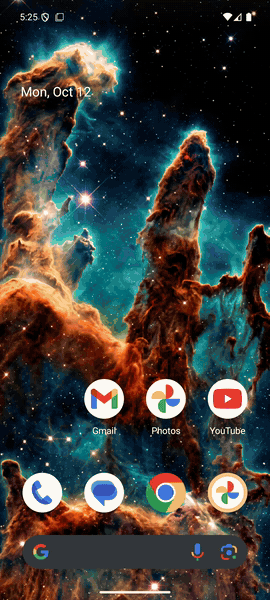 &nbsp;
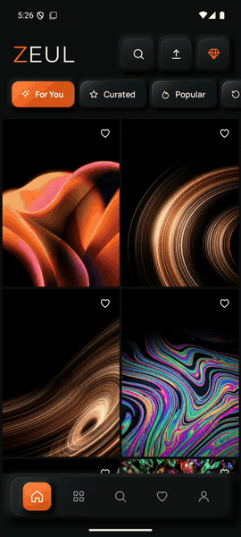

</div>

---

## Contents

- [Download](#download)
- [Features](#features)
- [Screenshots](#screenshots)
- [By the community, for the community](#by-the-community-for-the-community)
- [Architecture](#architecture)
- [How it was made](#how-it-was-made)
- [Tech stack](#tech-stack)
- [Project structure](#project-structure)
- [Build it yourself](#build-it-yourself)
- [Contributing](#contributing)
- [FAQ](#faq)
- [Credits](#credits) · [License](#license)

## Download

Grab the latest signed APK from **[Releases](https://github.com/raunakpatil/zeul/releases/latest)** and open it on your phone
(Android 8.0 or newer; allow "install unknown apps" for your browser or file manager when asked).

Every release lists its SHA-256 checksum so you can verify the file.

## Features

| | |
|---|---|
| 🖼️ **Curated feeds** | For You (learns from the styles you pick), Curated, Popular this week / month / all time, New, AMOLED, Tablet |
| 🔍 **Search** | Autocomplete, recent and trending tags, filters for colour, device, AMOLED and category |
| 👀 **Preview** | Full-screen, swipe between wallpapers, pinch to zoom, fake home / lock screen overlay, colour palette and details |
| 🎨 **Apply** | Home, lock or both, with crop, blur and dim before applying |
| 📤 **Community uploads** | Signed-in users publish their own wallpapers straight from the app, credited to them |
| ❤️ **Favourites & downloads** | Work offline; synced to your account when you sign in |
| 🔁 **Auto-changer** | A fresh wallpaper from your favourites, For You or a category every few hours |
| 🔐 **Accounts** | Google sign-in or a 6-digit email code; delete your account and data from the app |
| 🔔 **Push** | New drops and a daily hand-picked wallpaper (you can turn each off) |
| 📱 **Tablets & foldables** | Navigation rail, list-detail two-pane, 3–4 column grid |
| 🌗 **Light & dark** | Soft neumorphic light theme, orange-on-black dark theme with real depth |
| 🐹 **The hamster** | A boot intro with a Looney Tunes iris-out, and an encore in the Premium button |

## Screenshots

<table>
<tr>
<td>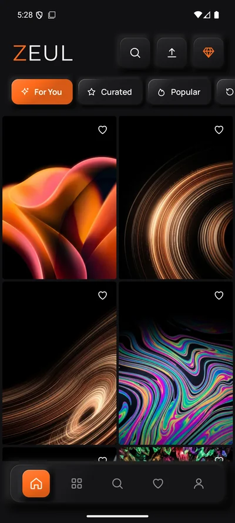</td>
<td>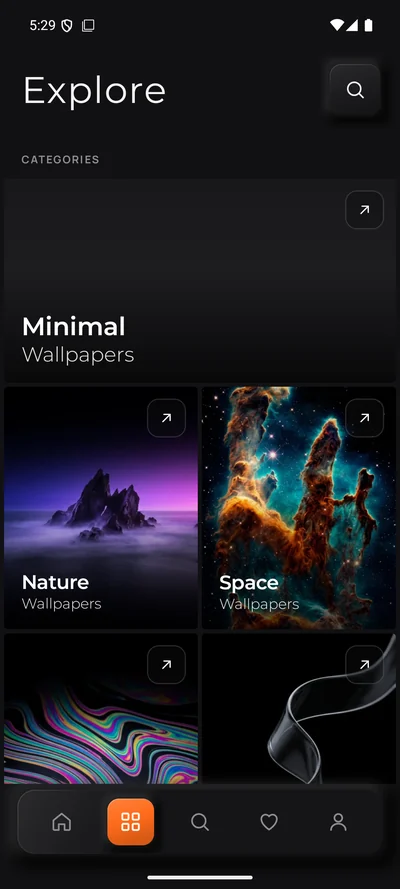</td>
<td>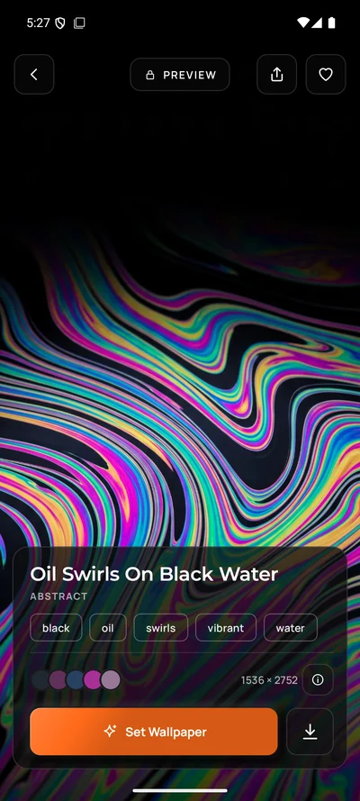</td>
<td>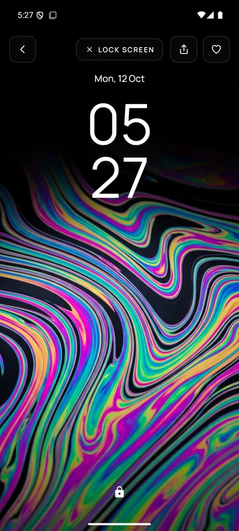</td>
</tr>
<tr>
<td align="center"><sub>Home</sub></td><td align="center"><sub>Explore</sub></td><td align="center"><sub>Preview</sub></td><td align="center"><sub>Lock screen preview</sub></td>
</tr>
<tr>
<td>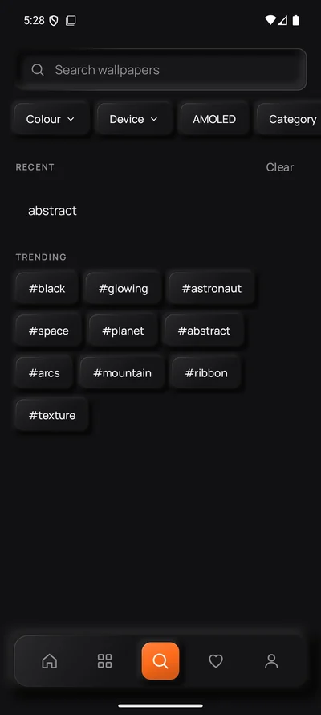</td>
<td>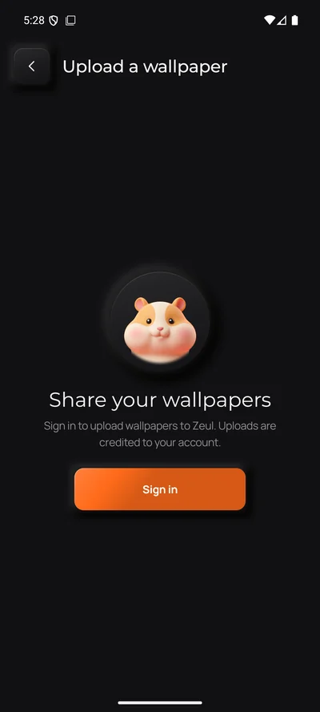</td>
<td>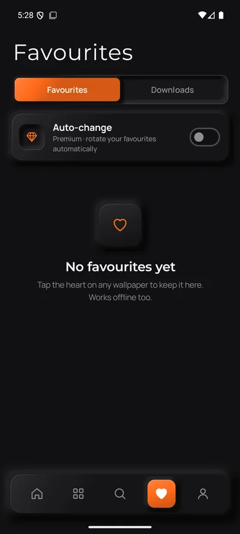</td>
<td>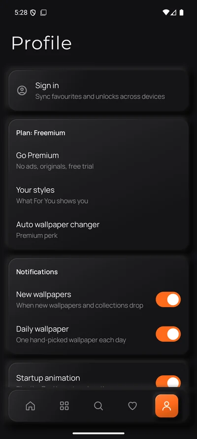</td>
</tr>
<tr>
<td align="center"><sub>Search</sub></td><td align="center"><sub>Upload</sub></td><td align="center"><sub>Favourites</sub></td><td align="center"><sub>Profile</sub></td>
</tr>
</table>

<details>
<summary><b>Light theme</b></summary>
<br>
<table>
<tr>
<td>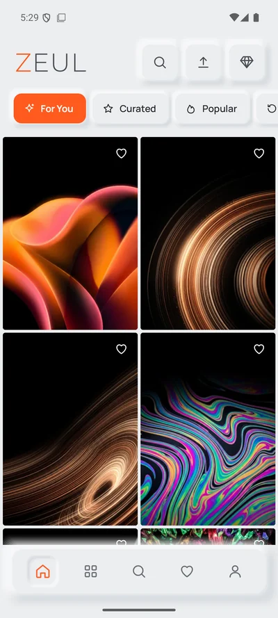</td>
<td>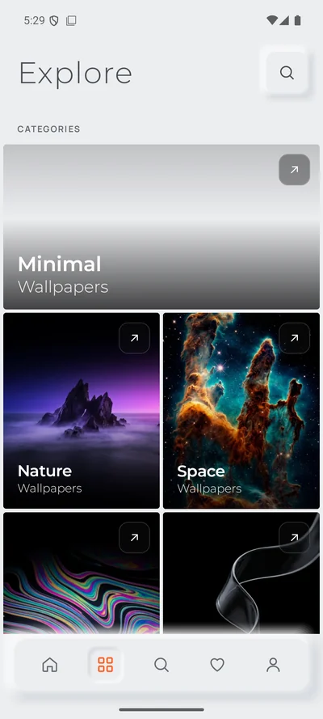</td>
<td>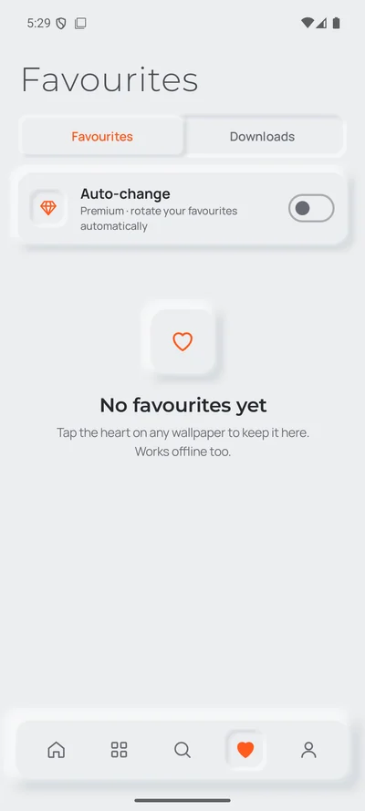</td>
<td>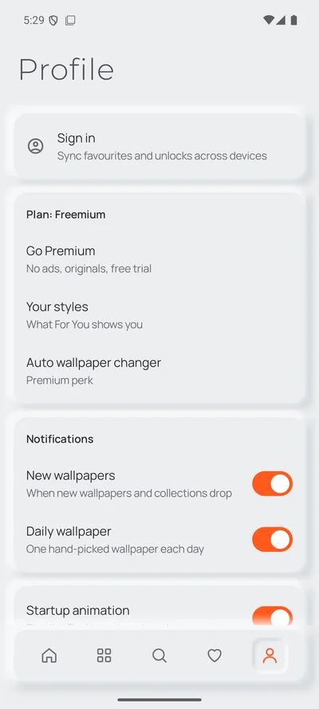</td>
</tr>
</table>
</details>

<details>
<summary><b>Onboarding and Premium</b></summary>
<br>
<table>
<tr>
<td>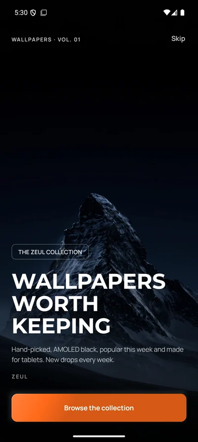</td>
<td>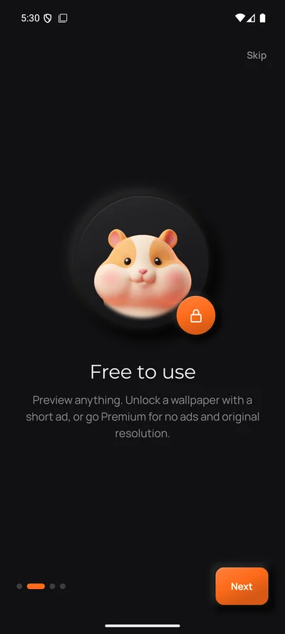</td>
<td>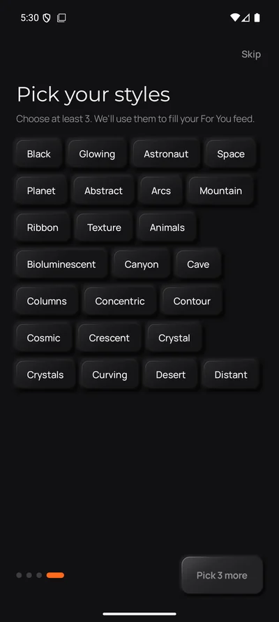</td>
<td>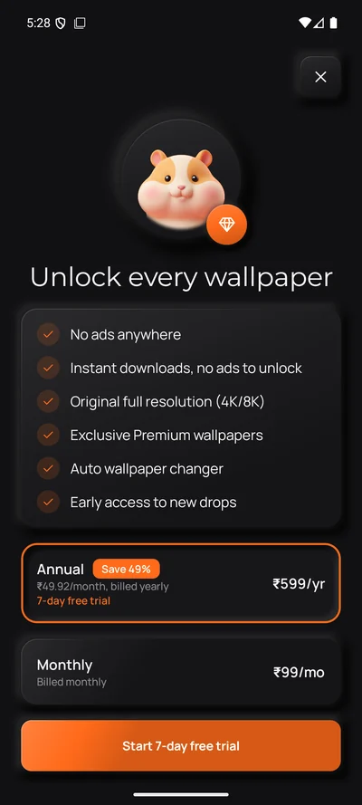</td>
</tr>
</table>
</details>

## By the community, for the community

Zeul is free to use, free to read and free to change. Two things make it a community app:

1. **The code is open** (GPL-3.0). Fork it, learn from it, send a pull request.
2. **The wallpapers can come from you.** Sign in, tap the upload button on Home, pick a photo, name it, choose a category, publish.

Uploads go live straight away, so the guardrails are built in rather than bolted on:

| Guardrail | How |
|---|---|
| Real accounts only | Uploading needs Google or email sign-in; guests can browse but not upload |
| You have the rights | A checkbox confirms you made the image or may share it, with a link to the content rules |
| Credit | Your display name is shown as the author |
| Daily limit | 5 uploads per person per day (adjustable from the dashboard) |
| Reports hide fast | Any wallpaper can be reported; a community upload is hidden automatically after 3 reports from different people |
| Moderation | Admins review reports, delete uploads and switch off uploading for an account |
| Your control | "Your uploads" lists everything you shared, with downloads and favourites, and lets you delete any of them |
| Privacy | The phone re-encodes every image before upload, which strips EXIF data such as GPS location |

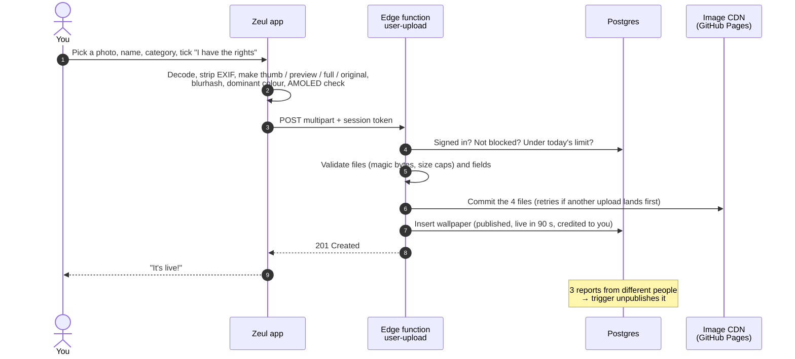

## Architecture

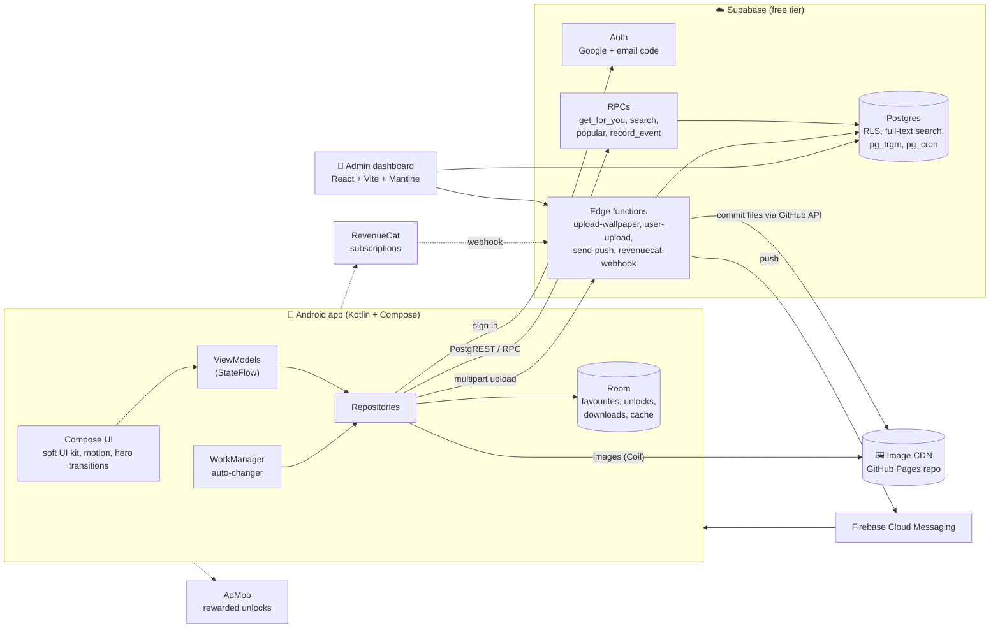

**Why this shape:** the whole thing had to cost nothing while it grows. Postgres does the heavy lifting
(row-level security, ranking, search and rate limits live in SQL), images are static files on GitHub Pages
behind a CDN, and the few things that need secrets (committing to the image repo, sending pushes, the billing
webhook) are small edge functions. The app talks to one documented contract, [`docs/CONTRACTS.md`](docs/CONTRACTS.md).

<details>
<summary><b>Data model</b></summary>

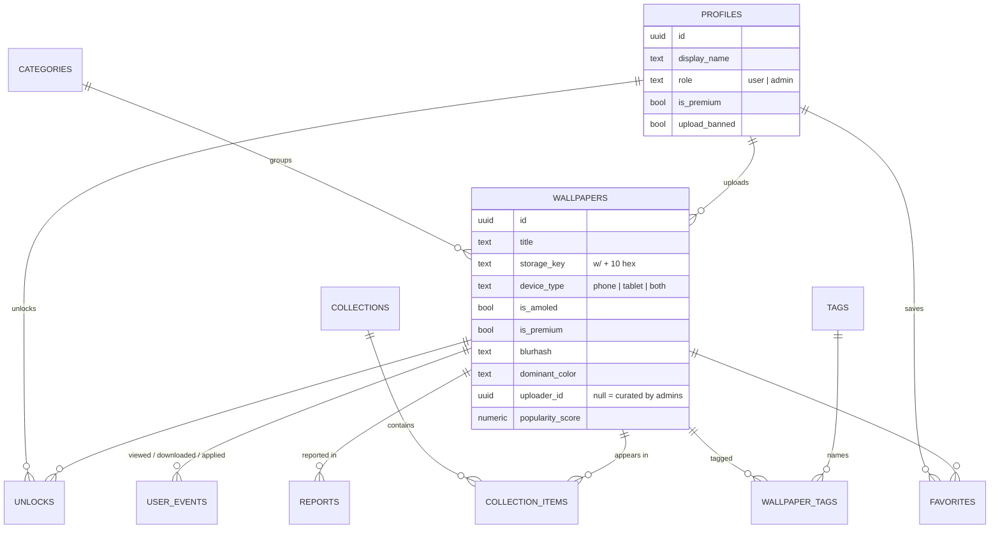

</details>

<details>
<summary><b>Inside the Android app</b></summary>

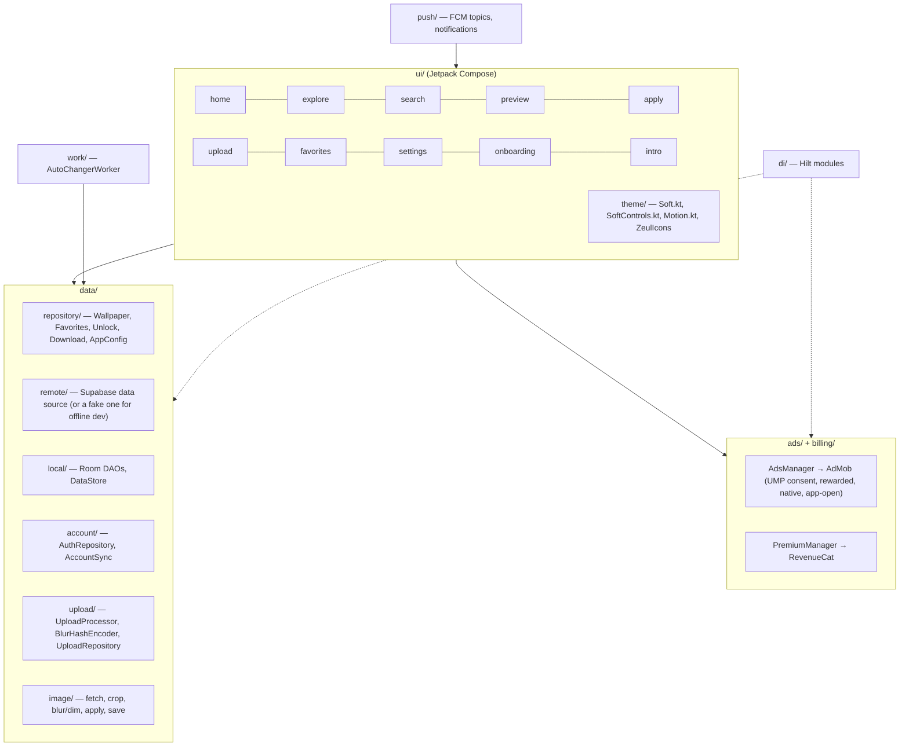

- **Single activity**, type-safe Navigation Compose routes, shared-element hero transitions from grid to preview.
- **Unidirectional data flow:** screens observe a `StateFlow` UI state; repositories hide where data comes from.
- **Offline first where it matters:** favourites, unlocks and downloads live in Room and sync to the account in the background.
- **Interfaces at the money edges:** `AdsManager` and `PremiumManager` have fake implementations, so the UI was built and tested before ads or billing existed.

</details>

## How it was made

Zeul was built by **two developers in about two weeks**, each working with their own
[Claude Code](https://claude.com/claude-code) agent, coordinating through files in git instead of meetings:

- **One contract.** Every table, RPC, image path, config key and Kotlin interface the two sides share is written down in [`docs/CONTRACTS.md`](docs/CONTRACTS.md) *before* it is built. Changing it is a deliberate, labelled commit.
- **A board and a log.** Who owns which task, requests to the other developer, and a hand-off note at the end of every session. Each agent read them at the start of a session, so work never collided.
- **Clear ownership.** Raunak: backend, dashboard, ads and billing, launch. Ghanshyam: the Android app. When one was away, the other picked up a task and handed it back with notes.
- **Verified, not assumed.** Every change was built, unit-tested and checked on an emulator (light and dark) before merging; real-phone checks were logged separately. CI builds and tests every push.

<p align="center">
  <picture>
    <source media="(prefers-color-scheme: dark)" srcset="docs/media/charts/commits-dark.svg">
    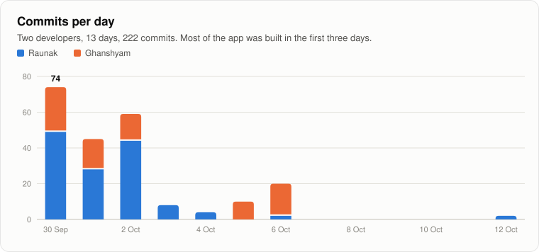
  </picture>
</p>

<p align="center">
  <picture>
    <source media="(prefers-color-scheme: dark)" srcset="docs/media/charts/code-dark.svg">
    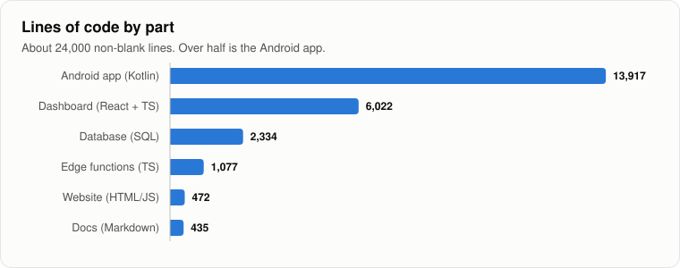
  </picture>
</p>

<details>
<summary><b>The design</b></summary>

- **Soft UI.** Light mode is neumorphic: every surface is the background colour, lifted by a pale shadow up-left and a darker one down-right. Dark mode is orange on black and gets its depth from a top-lit sheen and a thin light rim. Shadows are drawn by hand as stacked, fading outlines, because blur effects render as hard "ghost" copies on some GPUs. See [`docs/design/app-ui-soft.md`](docs/design/app-ui-soft.md).
- **Motion.** One set of springs (`ZeulMotion`) for everything; press feedback with haptics; staggered grids; hero transitions.
- **The boot intro.** A video of the hamster mascot zooms in and waves, then the app opens with a Looney Tunes iris-out, and the hamster makes a short encore inside the Premium diamond. Cold starts only, skippable, and off for deep links. See [`docs/design/boot-intro.md`](docs/design/boot-intro.md).

</details>

## Tech stack

| Layer | What |
|---|---|
| **Android** | Kotlin 2.4 · Jetpack Compose (BOM 2026.09) · Material 3 · Hilt · Navigation Compose · Room · DataStore · Paging 3 · WorkManager · Coil 3 · Telephoto zoom · Credential Manager (Google sign-in) |
| **Backend** | Supabase: Postgres 17 with RLS, full-text search, `pg_trgm`, `pg_cron`; Auth; Deno edge functions |
| **Images** | GitHub Pages as a free CDN; WebP variants (400 px thumb, 1080 px preview, up to 2560 px full) + original |
| **Dashboard** | React 19 · TypeScript · Vite 6 · Mantine 8 |
| **Money** | AdMob (rewarded unlocks, native, app-open, UMP consent) · RevenueCat (monthly / annual with a free trial) |
| **Push** | Firebase Cloud Messaging (topics), sent by an edge function on a schedule |
| **Quality** | 104 unit tests, Compose UI tests, Android lint, ESLint, GitHub Actions CI |

## Project structure

```
android/      the app (Kotlin + Jetpack Compose)
  app/src/main/java/com/wallpaperapp/app/
    ui/        screens + the soft UI kit (theme/)
    data/      repositories, Supabase + Room, uploads, image processing
    ads/       AdMob behind AdsManager
    billing/   RevenueCat behind PremiumManager
    work/      auto-changer      push/  notifications
dashboard/    admin dashboard (React + Vite + Mantine)
supabase/
  migrations/ the schema, RLS, RPCs, cron jobs, rate limits (apply in order)
  functions/  edge functions (Deno)
  tests/      SQL smoke tests
docs/
  CONTRACTS.md  the shared contract between app, dashboard and backend
  design/       UI and boot-intro design notes
  site/         privacy policy, terms and the share-link page (GitHub Pages)
  media/        screenshots, GIFs and charts for this README
brand/        logo, icons, the boot video
```

## Build it yourself

### Quick start (no backend needed)

```bash
git clone https://github.com/raunakpatil/zeul.git
cd zeul/android
cp local.properties.example local.properties   # then set USE_FAKE_BACKEND=true
./gradlew installDebug
```

With `USE_FAKE_BACKEND=true` the app runs on built-in sample data, so you can work on the UI right away.
Debug builds always use Google's test ads. Requirements: JDK 17+ and the Android SDK (Android Studio is easiest).

### Your own backend

1. Create a free [Supabase](https://supabase.com) project and run every file in `supabase/migrations/` in order (SQL editor or `supabase db push`), then `supabase/seed.sql` if you want sample categories.
2. Create a public GitHub repo for images and enable Pages. Give the edge functions a fine-grained token for it as the `GITHUB_TOKEN` and `CDN_REPO` secrets (step by step in [`supabase/README.md`](supabase/README.md)).
3. Deploy the edge functions: `npx supabase functions deploy upload-wallpaper` and `user-upload`.
4. Put your project URL and publishable key into `android/local.properties` and `dashboard/.env` (see the `.example` files).
5. Run the dashboard: `cd dashboard && npm install && npm run dev`, sign in, make your account an admin (`update profiles set role = 'admin' where id = '<your user id>'`), and upload wallpapers.

Optional: Google sign-in (an OAuth client), Firebase for push (`google-services.json`), AdMob and RevenueCat keys. Every one is optional; the app hides what isn't configured.

### Release build

```powershell
powershell -ExecutionPolicy Bypass -File android\scripts\make-release-key.ps1   # once: creates your key outside the repo
cd android; .\gradlew assembleRelease
```

## Contributing

Contributions are welcome, whether code, design, translations or wallpapers. Start with **[CONTRIBUTING.md](CONTRIBUTING.md)**,
and please follow the **[Code of Conduct](CODE_OF_CONDUCT.md)**. Found a security problem? See **[SECURITY.md](SECURITY.md)** (please don't open a public issue).

- 🐛 [Report a bug](https://github.com/raunakpatil/zeul/issues/new?template=bug_report.yml)
- 💡 [Suggest a feature](https://github.com/raunakpatil/zeul/issues/new?template=feature_request.yml)
- 💬 [Ask or share in Discussions](https://github.com/raunakpatil/zeul/discussions)

## FAQ

<details><summary><b>Is Zeul free?</b></summary>

Yes. Zeul is free to download and use, and its source code is open under GPL-3.0. Some wallpapers unlock after a short ad.
</details>

<details><summary><b>How do I install the Zeul APK on Android?</b></summary>

Open the [latest release](https://github.com/raunakpatil/zeul/releases/latest) on your phone, download `zeul-1.0.0.apk`, open it and allow your browser or file manager to install apps when asked. Android 8.0 or newer.
</details>

<details><summary><b>Can I upload my own wallpapers?</b></summary>

Yes. Sign in, tap the upload button on Home, pick a photo (at least 720 × 1280), name it and choose a category. It goes live for everyone, credited to you. Up to 5 a day; delete them any time from Profile → Your uploads.
</details>

<details><summary><b>Do I need an account?</b></summary>

No. Browsing, downloading and setting wallpapers work without one. Signing in syncs favourites across devices and lets you upload.
</details>

<details><summary><b>What are AMOLED wallpapers?</b></summary>

Wallpapers with mostly pure black (#000000) backgrounds. On OLED / AMOLED screens black pixels are off, so they look deep and can save battery. Zeul has a dedicated AMOLED section.
</details>

<details><summary><b>Can I fork Zeul and build my own wallpaper app?</b></summary>

Yes, under the GPL-3.0: your fork must stay open source. Please use your own name and logo. [Build it yourself](#build-it-yourself) shows how to run it on your own backend.
</details>

## Credits

| | |
|---|---|
| **[Raunak Patil](https://github.com/raunakpatil)** | Backend, dashboard, ads & billing, design system, launch |
| **[Ghanshyam Paunikar](https://github.com/GhanshyamPaunikar)** | Android app: UI, data layer, preview, search, onboarding, tablets, background work |

Built with [Claude Code](https://claude.com/claude-code). Wallpapers belong to their creators: curated ones are licensed for the app, community ones are shared by their uploaders.

## License

Zeul's code is licensed under the **[GNU General Public License v3.0](LICENSE)**: you may use, study, share and change it, and
anything you distribute that builds on it must be open source under the same licence.
The Zeul name, hamster mascot and logo are not covered by the code licence; please use your own branding for forks you publish.
